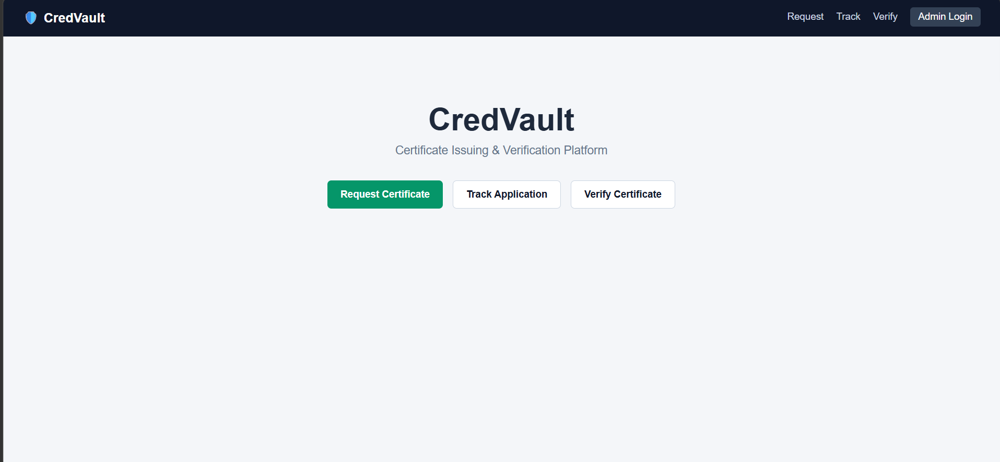
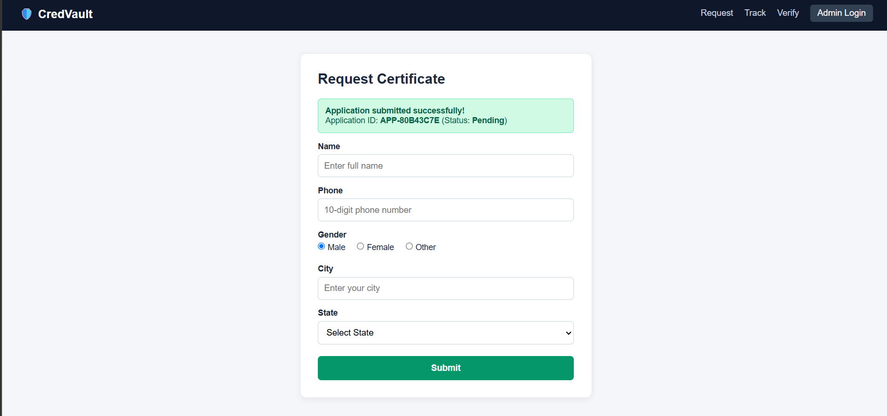
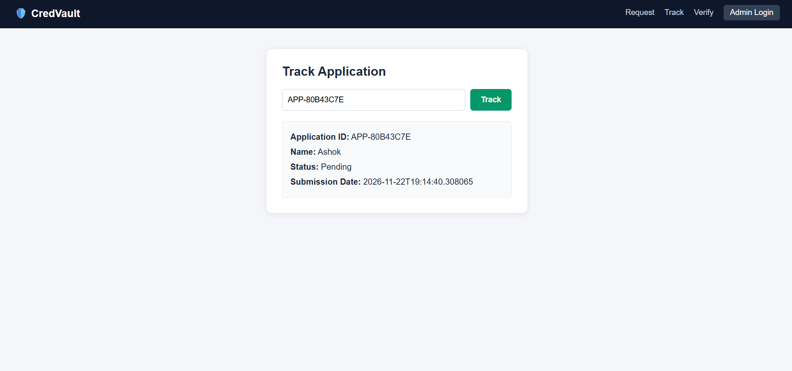
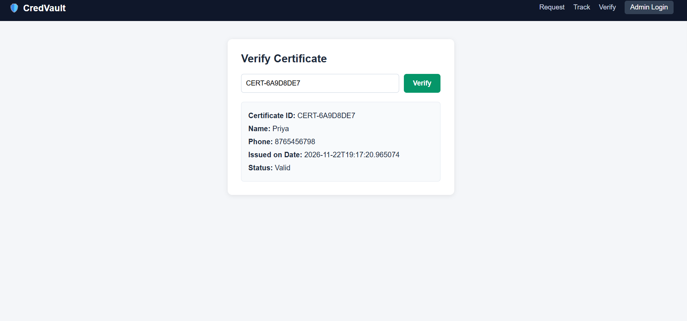
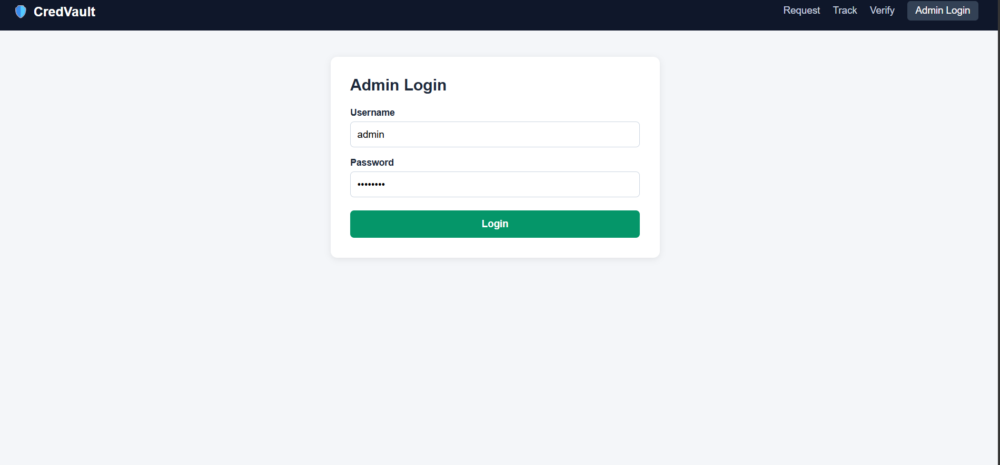
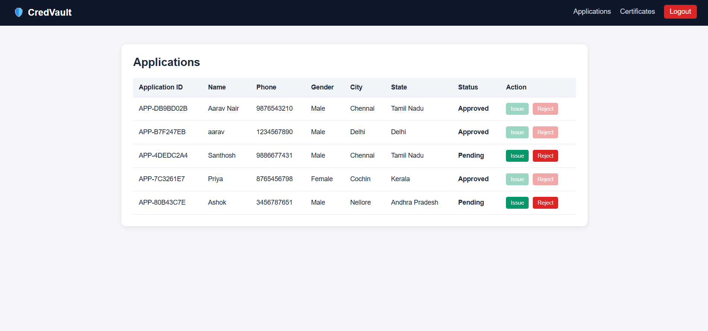
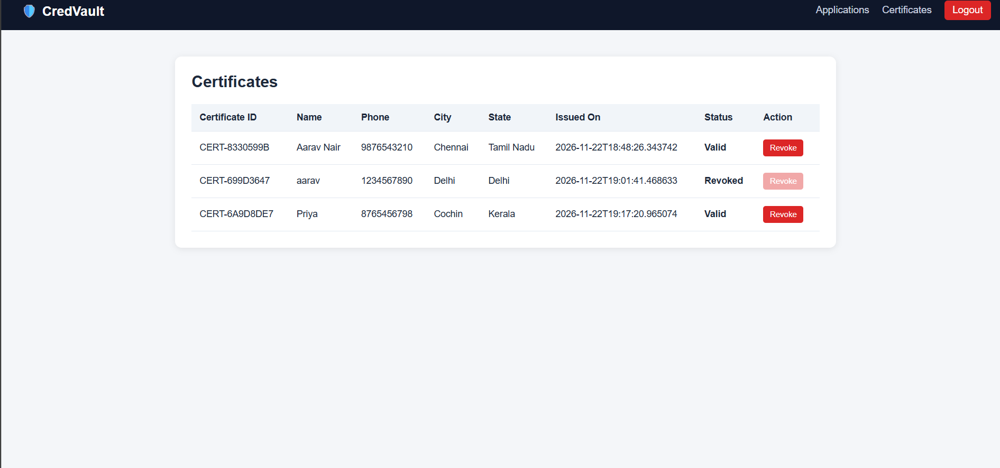

# CredVault — Full-Stack Certificate Issuing & Verification Platform (`ELEVATE-SDE-Task-4`)

Full-stack integration of **CredVault**, connecting a vanilla HTML/CSS/JavaScript frontend with a Spring Boot + H2 REST API backend (`http://localhost:8080`).

## Website Screenshots

### Home Page

### Request Certificate (`/request`)

### Track Application (`/track`)

### Verify Certificate (`/verify`)

### Admin Login

### Admin Applications Management

### Admin Certificates Management

---

## Features & API Endpoints

- **Citizen Application Submission** (`POST /api/applications`): Submit certificate requests and receive a generated Application ID (`APP-...`).
- **Application Tracking** (`GET /api/applications/track/{applicationId}`): Real-time status lookup (`Pending`, `Approved`, `Rejected`).
- **Public Certificate Verification** (`GET /api/certificates/verify/{certificateId}`): Validates certificate authenticity and displays holder name, phone, issue date, and status (`Valid` or `Revoked`).
- **Admin Authentication & Management**:
  - `POST /api/admin/login` — Admin login (seeded credentials: **`admin`** / **`admin123`**)
  - `GET /api/admin/applications` — View all submitted applications
  - `PATCH /api/admin/applications/{applicationId}/approve` — Approve application & issue certificate (`CERT-...`)
  - `PATCH /api/admin/applications/{applicationId}/reject` — Reject application
  - `GET /api/admin/certificates` — View all issued certificates
  - `GET /api/admin/certificates/{certificateId}/revoke` — Revoke an active certificate

---

## How to Run Locally

1. **Start the Backend (Spring Boot on `http://localhost:8080`)** — open a terminal in `backend/` and run `.\mvnw.cmd spring-boot:run`.
2. **Open the Frontend** — open `frontend/index.html` in your browser (or serve `frontend/` using VS Code Live Server) while the backend is running.